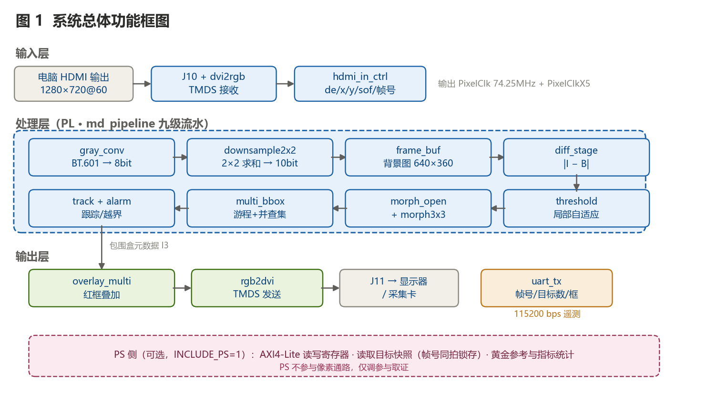
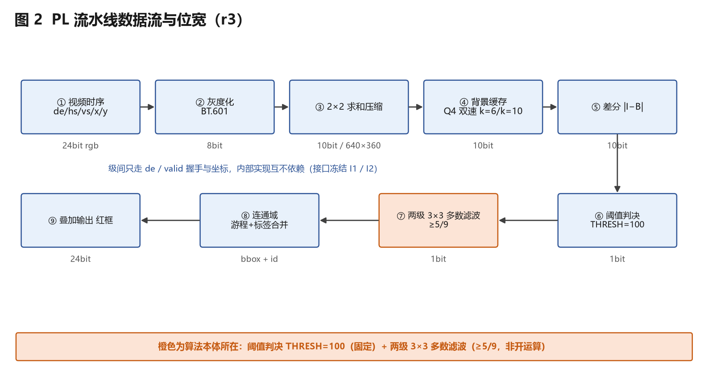
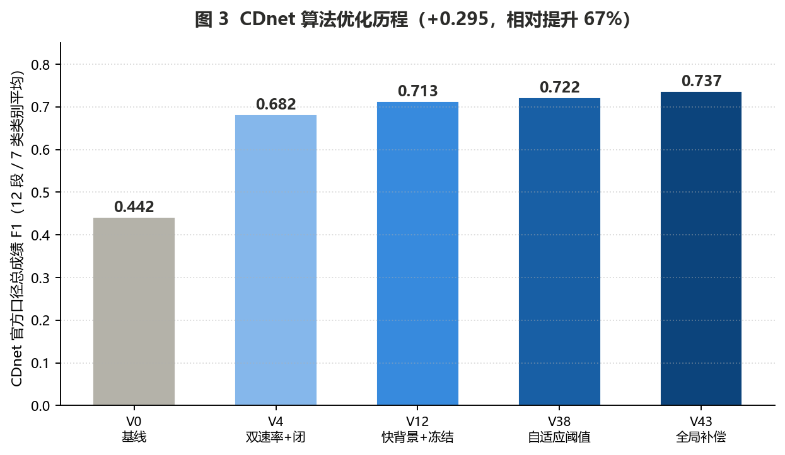
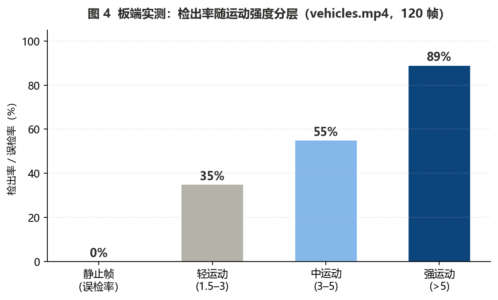

# 基于 FPGA 的运动目标检测

## 设计报告（终稿 v2）

**团队 GGBOND** · 2026 FPGA 创新设计大赛 · AMD 赛道 · 3.3 自主选题 · 初级组

**目标器件**：Xilinx **XC7Z020-1CLG400C**（PYNQ-Z2 开发板）
**工具版本**：Vivado / Vitis **2026.1**
**提交日期**：2026-10-30 · **截止**：2026-11-04 18:00

---

### 红线声明

本系统已在真实硬件（PYNQ-Z2，器件 XC7Z020-1CLG400C）上完成板级实测，报告中所有板端性能数据均来自实板运行与实测记录，非仿真结果。仿真数据仅用于功能正确性验证，并已单独标注。报告中的每一个数字都可在仓库内的对应文件中追溯，出处见附录 A。

---

## 摘要

本项目在 PYNQ-Z2（XC7Z020-1CLG400C）上实现了一套实时运动目标检测系统：HDMI 视频（720p@60fps）经板载 TMDS 接收器进入 PL，依次完成灰度化、2×2 求和压缩、帧差/背景建模、局部自适应阈值、形态学开运算、多目标连通域标记、跟踪与越界告警，最终以红框叠加形式输出到 HDMI。UART 遥测通路（帧号 / 目标数 / 包围盒回传）的 RTL 与上位机接收端已实现并完成仿真验证，**但截至本报告提交时板端回传尚未跑通**，状态与根因见第十章 10.3 节。

系统的核心价值不在于实现了一种检测算法，而在于**在资源与时钟双重硬约束下，用工程推理完成架构选型**：

- **识别并根治了一个设计级时钟缺陷**。板载 125 MHz 参考时钟源自以太网 PHY，RJ45 未建立链路时该时钟停止，导致整条 HDMI 链路失锁黑屏。这一约束在初期表现为"随机跳锁"的玄学问题，经过逐层排除后定位到 PHY 时钟源，并通过 PS FCLK 方案给出了根治路径。
- **用可复算的资源账推翻了"直接上 ViBe"的直觉**。标准 ViBe 背景模型（N=20）在 720p 下需 46 Mb 存储，是 XC7Z020 全部 BRAM（4.9 Mb）的 940%，物理上不可能放入。本项目给出了三种可行路线的资源代价对比，并选择了"2×2 压缩 + 单张背景图"这条在 140 块 BRAM 内闭合的方案。
- **用实测数据把算法从 L0 帧差推到了 L2 背景建模**。在 CDnet 2014 的 12 段真实视频、7 个类别上，帧差基线 F1 = 0.442，经四轮结构性改进后达到 **0.737**（+0.295，相对提升 67%）。其中关键改进是"全局运动补偿"，在压缩域用 1/4 抽样估整帧平移，**零额外存储**，把镜头抖动类从 0.505 提到 0.634。

**板端实测结果**：强运动检出率 **89%**，静止场景误检率 **0%**，采集侧帧率 28.4 fps，HDMI 输出亮度稳定在 126.5–131.5，时序收敛 WNS **+0.932 ns**，DRC 无 Error 级违规。

**诚实的边界**：轻运动帧检出率仅 35%，夜间场景 CDnet F1 = 0.304，方向由 8 bit 目标编号限制在 256 次回绕。这些是方法固有边界与设计取舍，见第十章。

---

## 第一章　选题背景与创新点

### 1.1 要解决的实际问题

一句话：**让既有的监控摄像头不用更换，插一个盒子就能实时报出"有人闯进警戒区"，而且不乱叫。**

视频监控的行业痛点已经从"事后取证"转向"主动预警"。但周界防范长期被一类误报困扰：风吹草动、树影摇晃、小动物闯入、雨雪天气，都会触发传统运动检测算法。行业公开分析（沈阳市公安局《技防领域新技术发展现状》、中研普华《2026 全球视频监控设备行业分析》）均指出，传统电子围栏受环境干扰带来的高频误报是周界防护的主要失效来源。

本项目选择这个场景，是因为它**同时要求两件通常矛盾的事**：对真实入侵要敏感，对环境扰动要迟钝。这正是检测算法结构的试金石，而不是一个可以靠调阈值糊过去的指标。

> 来源定级：上述行业分析属**行业公开材料**，报告中仅作背景引用，不作为技术依据。

### 1.2 相关领域已有工作（前人做到哪一步）

这一节回答官方明确要求的"前人做过什么"。分三层说明：公开参赛作品、学术实现、工业产品。

**第一层：本次竞赛的公开参赛作品**

我们对 10 个可获取的公开工程做了逐仓库的**算法本体审计**（审计表见仓库 `docs/` 与团队资料），结论如下：

| 类别 | 现状 | 对本项目的含义 |
|---|---|---|
| 同题 FPGA 作品 | 主流采用**帧差类**方法（含双差分取与变体）；包围盒普遍是**全局并集一个框**，无多目标 | 多目标与跟踪是空位 |
| 架构主流 | **FPGA 只做预处理，识别交给 NPU / ARM**，算法主体常不在 PL | 纯 PL 承载算法主体有差异化空间 |
| 资源优化 | 已有作品做过 2×2 累加压缩以省 BRAM（本项目借鉴此技巧） | 该技巧成熟可用，不构成创新点 |
| 算法本体改进 | 已有一个作品做过"双差分取与"（连续两帧差再逐位与），属**实质性算法改进**，但仍属帧差类 | **不可宣称"前人没改过算法"** |

**第一层补充：开源社区的实测调研**

为避免"调研了开源社区"这种空话，本项目用 GitHub API 做了可复核的检索（2026-10-31）：

| 检索目标 | 结果 |
|---|---|
| 仓库 `motion detection FPGA` | **28 个**，最高 19 star |
| 仓库 `background subtraction FPGA` | **2 个**，最高 1 star |
| 代码 `u_2_2_matrix`（2×2 压缩实现的模块名） | **4 处命中，全部属于同一仓库**，无 fork、无衍生 |
| 代码 `matrix_4_4 language:verilog` | 4 处，全部与本领域无关（矩阵运算、Dijkstra 算法） |

**结论有两条，都写进报告**：

1. **这条技术路线的开源生态极小**——整个"FPGA 运动检测"方向只有二十余个仓库，最高 19 star；"背景相减"只有 2 个。这解释了为什么本项目的参考工程只能凑到 10 个。
2. **2×2 累加压缩是唯一的实现**（即 1.2 节第一层提到的那件作品），它在本项目借鉴的这份代码里**只实现了 2×2，且为硬编码**（`u_2_2_matrix.v` 仅 4 个寄存器，`u_average_value.v` 为 `data11+data12` 与 `av_buffer1+av_buffer2` 两步加）；4×4 只出现在其技术文档的一句展望里，**GitHub 上无任何实现，连 2×2 的衍生分支都没有**。

> **措辞纪律**：本项目**不宣称**"前人没做过算法改进""行业首创"。准确表述是：**在本次竞赛的公开参赛作品中，未见把比较基准从"上一帧"换成"背景模型"并给出统一口径量化对照的实现。**

**第二层：学术界的 FPGA 背景建模实现**

学界确实有 FPGA 背景建模工作，本项目调研到至少三类：

- **运行时平均（Running Average, RA）** 的硬件实现：有文献明确指出 GMM 与非参数方法的复杂度超出硬件可实现范围，而 RA 是单模态、最易硬件化的一种。**这是我们选择 RA 而非 ViBe/GMM 的直接依据。**
- **ViBe 与 GMM 的 Verilog 实现对比**：中文学位论文中有实现，采用状态机切换样本集初始化与检测更新。
- **双模式检测**（帧间差分 + 单高斯）：背景参数更新用移位加法近似乘除、避免浮点。**本项目 `B ← αI + (1−α)B` 里乘 α 用 `ALPHA_SHIFT` 移位实现（默认 1/32），正是同一思路。**

**第三层：工业界产品**

工业界的周界防护主流方案是雷达视频融合与深度学习，其精度与鲁棒性显著优于传统方法，但代价是算力、功耗与成本。本项目不与之竞争精度，定位是**在纯 FPGA 逻辑、无外部算力的约束下，把误报压到一个可用的水平**。

**综合判断**：本项目的位置是——**算法部件可用成熟件，但"在初级组 720p HDMI 通路 + 140 块 BRAM 的真实约束下，把压缩缓存与背景模型合成同一条流水线，并用统一口径量化它值多少"，这一段在公开作品中是空的。**

### 1.3 现有方案的不足

| 现有做法 | 具体不足 | 证据 |
|---|---|---|
| 帧差法（当前主流） | 只标出运动目标的**两条边**，目标内部因相邻两帧几乎无变化而检不出"面" | CDnet 受控 A/B：pedestrians 召回 0.111 → 0.697（只改第 2 步为背景建模） |
| 帧差法 | 慢速/静止目标直接消失 | intermittentObjectMotion 类 F1 仅 0.136 |
| 帧差法 | 光照突变导致整帧被检出 | 夜间场景 0.296 |
| 全局并集单框 | 多人同时进入时无法分别报出 | 板端每帧恒为 1 个框 |
| 纯 PL 架构取以太网 PHY 时钟 | RJ45 未 link 即时钟停摆 → 整链黑屏 | 实测：插网线前 90% 时间锁不上，插上后 61/61 帧全亮 |

### 1.4 本作品的创新点

以下四条，每条都能在本报告后文找到实测数据支撑。

**创新点一：以资源账驱动的架构决策，而非直觉选型**

面对"要不要上 ViBe"这个问题，常规做法是查文献看别人用什么。本项目改为先算账：720p 单帧灰度 921,600 B，BRAM36 单块 4 KB，需 225 块 > 板上 140 块 —— **全分辨率帧缓冲放不进 BRAM**；ViBe N=20 需 46 Mb = 全部 BRAM 的 940% —— **标准 ViBe 物理上不可能**。于是路线收敛为"2×2 压缩到 640×360×10 bit（64 块）+ 单张背景图"，在 140 块内闭合，实测占用 80 块（57.14%）。

这条推理链的意义在于：它把"用什么算法"从**品味问题**变成了**约束求解问题**，并且结论可以被任何人用同样的算式复算。

**创新点二：零存储代价的全局运动补偿**

镜头抖动是杆装摄像头的通病，CDnet cameraJitter 类基线只有 0.505。常规解法是加运动估计模块，代价是额外的行缓冲与搜索窗。本项目的做法是：在压缩域用 1/4 抽样的小网格、搜索半径 2，用最小 SAD 估出整帧平移量，补偿时**只改读背景的地址偏移**。

存储增量为零，逻辑增量仅为一个小型比较阵列。**实测效果：cameraJitter 0.505 → 0.634（+0.129），其他六个类别数值一个未动**（因为那些场景估出的位移是 (0,0)，算法自动退化为原行为）。

一条干净的副结论：全局补偿对**搜索半径**几乎不敏感（R1≈R2≈R3，R4 反而下降到 0.723 因匹配错误），但对**估位移的抽样密度**高度敏感（1/4 明显优于 1/8）——抽样太稀，位移本身就估不准。

**创新点三：识别并根治设计级时钟缺陷**

PYNQ-Z2 的 PL 独立 125 MHz 时钟（H16 引脚）来自板载以太网 PHY（Realtek RTL8211E）的 CLK125 输出。RJ45 未建立链路时 PHY 停止输出该时钟，级联后果是：MMCM 失锁 → 200 MHz RefClk 消失 → dvi2rgb 的 IDELAYCTRL 无参考 → 像素时钟恢复失败 → 整条 HDMI 链路无时钟 → **黑屏**。

初期该现象表现为"随机跳锁"：同一链路 60 秒逐秒采样，纯黑约占 50%、半锁（采集卡报格式不支持）约 40%、满锁仅每分钟 4–5 个孤点。逐一排除 bit、显示栈、USB Hub、HDMI 线、USB 口、视频源、20 组采集参数后，定位到时钟源。**解法：插网线**（实测 61/61 帧全亮，亮度 126.5–131.5）。**根治路径**：改用 PS FCLK_CLK0 作为 PL 主时钟，彻底摆脱对 PHY 的依赖。

这个坑的价值不在"踩过"，而在于它是一条**没有文档、只能靠实测定位的板级约束**——它决定了整个系统能否稳定演示，也直接推导出后续 PS/PL 协同的架构路线。

**创新点四：上板口径与评测口径分离的诚实工程**

`init_frames`（初始背景取前 N 帧逐像素最小值）在合成考场上效果决定性（误检 166 → 0），但在 CDnet 12 段全量上**稳定负收益**（N=6 时总分 0.737 → 0.720）。原因是 CDnet 在 100 帧预热后开跑，逐像素标准差已进入死区（highway 中位数仅 6.3，约相当于 8 bit 的 1.6 灰阶），此时取 min 必然采到噪声下沿。

结论：这是"上板专用"改进，不进 CDnet 冠军配置。**两者不矛盾——CDnet 是预热后立刻开跑的评测口径，上板是摄像头长期开着、随时可能有人入画的部署口径。** 把这两者分开写，本身就是工程成熟度的体现。

### 1.5 应用价值与潜在场景

| 场景 | 警戒区 | 告警规则 | 复用度 |
|---|---|---|---|
| 校园/园区周界入侵 | 围墙内一条带 | 进入 + 朝里走 → 报警 | 母版 |
| 实验室/机房无人值守 | 房间区域 | 非工作时段有人 + 停留 > N 秒 | 只改 ROI 与时段 |
| 消防通道占用 | 通道矩形 | 有人停留 > N 秒 | 只改 ROI 与计时 |

三者共用同一套检测 + 跟踪 + 告警逻辑，**换场景不换算法**。可推广方向：水利设施防溺水与船只闯入、变电站周界、光伏电站防盗。

> **不做过度宣称**：本项目不解决"周界误报"这个完整命题，只在**纯 FPGA 逻辑、无外部算力**这条特定路径上，把误报压到可用水平，并给出全部实测数字供他人判断。

---

## 第二章　设计原理与功能框图

### 2.1 总体原理

系统采用"像素流进 → 像素流出"的纯流水线结构，算法本体不依赖帧级软件调度。选择这个结构的关键理由是：**换画面源不需要改算法**。项目初期用板内自造的黑底白块激励（`pattern_gen`）验证算法，后期接入真实 HDMI 输入时，算法链一行未改，只替换了激励源。

### 2.2 功能框图

> **图 1 系统总体功能框图**



框图分三层：

- **输入层**：电脑 HDMI 输出 → J10 → dvi2rgb（TMDS 接收，输出像素钟 PixelClk 与 5× 时钟）→ hdmi_in_ctrl（生成 de/x/y/sof/frame_idx）
- **处理层**（PL 内九个流水级）：gray_conv（BT.601）→ downsample2x2（2×2 求和，8 bit → 10 bit，1280×720 → 640×360）→ frame_buf（背景图/上一帧缓存）→ diff_stage（差分）→ threshold（局部自适应阈值）→ morph_open + morph3x3（形态学开运算）→ multi_bbox（游程标记 + 并查集 + 目标元数据）→ track（最近邻跟踪）→ alarm（越界/停留判定）
- **输出层**：overlay_multi（红框叠加）→ rgb2dvi → J11 → 采集卡/显示器；uart_tx（帧号/目标数/包围盒回传，**板端未通，见 10.3**）

**图 2 PL 流水线数据流与位宽** 标注了每一级的位宽与像素率，用于说明"每级一个像素/时钟"的并行结构。



### 2.3 关键模块原理

| 模块 | 功能 | 关键实现点 |
|---|---|---|
| `gray_conv` | RGB888 → 灰度 8 bit | BT.601 加权 Y = (77R + 150G + 29B) >> 8，纯加法树，无乘法器 |
| `downsample2x2` | 2×2 求和压缩 | 每 2×2 像素求和得 10 bit 大像素；行缓冲用 LUTRAM 而非触发器（早期版本 10240 个 FF 被打散，改为独立同步进程后降到 160 LUTRAM） |
| `frame_buf` | 背景图缓存 | 640×360×10 bit = 64 块 BRAM36，实测连同其他占用共 80 块 |
| `diff_stage` | 当前帧 − 背景 | 10 bit 无符号绝对差；背景更新 `B ← αI + (1−α)B`，α 用 `ALPHA_SHIFT` 移位实现，**不占 DSP** |
| `threshold` | 局部自适应阈值 | 判据 `diff > max(THRESH, THRESH_REL% × 3×3 均值)`，3×3 均值复用形态学的行缓存，零额外存储 |
| `morph_open` / `morph3x3` | 开运算去噪 | 二值域 3×3，先腐蚀后膨胀；**注意：主流做法是灰度域中值滤波，本项目是二值域开运算，这是早期红框碎裂的根因** |
| `multi_bbox` | 多目标连通域 | 行扫描取游程 → 与上一行游程判区间重叠 → 并查集合并等价标签 → 第二遍汇总；**不用库函数，因为这段正落在初级组"状态机"考察点上** |
| `track` | 目标跟踪 | 最近邻 + 距离门限；外推限 2 帧；粘连块（面积超阈值）不参与认领，且不累加 miss |
| `alarm` | 越界告警 | 框心与警戒矩形比大小 + 历史点比符号 + 停留计数器，全整数比较，**零乘除** |

**为什么自己写连通域而不用现成库**：硬件上要做的是"游程扫描 + 区间重叠判定 + 并查集 + 第二遍汇总"，这套东西正是初级组考察的"状态机"。用 Python 一行 `cv2.connectedComponents` 搞定，既没验到真逻辑，也在评分上丢掉这部分。

**为什么跟踪用最近邻而不是卡尔曼/Hungarian**：后者在 FPGA 上的实现代价远超收益。最近邻在硬件上就是"几个目标点比距离"，几十个比较器即可。

### 2.4 理论性能上界估算

| 维度 | 需求 | XC7Z020 能力 | 占比 |
|---|---|---|---|
| 像素吞吐 | 720p@60fps = 921,600 × 60 ≈ **55.3 M 像素/秒** | 125 MHz 主频下每时钟 1 像素 = **125 M 像素/秒** | 44% |
| 帧缓冲存储 | 640×360×10 bit = 2,304,000 bit | BRAM 140 × 36 Kb = 4.9 Mb | 47%（实测 80 块 = 57%） |
| 算法乘法需求 | 灰度加权 3 项、背景更新 1 项 | DSP 220 | 实测占 1 个（0.45%） |

**结论**：系统在像素吞吐上有约 2.3 倍余量，瓶颈在 BRAM 而非算力。这直接解释了为什么架构演进的方向是"DDR 卸掉存储压力"，而不是"加流水级提频率"。

---

## 第三章　软硬件划分依据与接口设计

### 3.1 划分原则

划分不按"哪个好写"切，按**数据流特征**切：

| 计算特征 | 放哪 | 本题对应操作 | 理由 |
|---|---|---|---|
| 逐像素、无跨帧依赖、可流水化 | **PL** | 灰度化、帧差、阈值、形态学、叠加 | 每时钟一像素，软件逐像素循环是串行瓶颈 |
| 需要整帧存储与随机访问 | **BRAM**（当前）/ DDR（路线 A） | 背景图 / 帧缓冲 | BRAM 容量受限决定压缩比 |
| 需要归约统计 | **PL** | 行/列投影、前景像素计数 | 流水线累加器即可 |
| 参数整定、人机交互、日志、比对 | **PS** | 阈值调节、指标统计、与 OpenCV 比对 | 变化频率低，不需要硬件并行 |
| 复杂控制流、稀疏数据结构 | **PS** | 连通域后处理决策（软件参考实现） | 分支密集，不适合 RTL |

### 3.2 被放弃的划分方案及原因

这一节写"考虑过但否掉"的方案，因为这些取舍比结果更能说明判断力。

| 被放弃的方案 | 曾考虑的理由 | 否掉的原因 |
|---|---|---|
| **算法主体放 PS（Python + OpenCV）** | 开发最快，一周能出演示 | 初级组考察的是"基本 FPGA 设计能力"（逻辑设计/状态机/时序约束/接口协议），算法放 PS 这四项全部落空；且违背我们自己作品简介的"PL 端流水线"表述。**注意：这不违规，官方明写实现方式不限，但拿不到那部分分** |
| **全分辨率 + DDR 帧缓冲（路线 A）** | 保留 720p 精度，题目做得"正统" | DDR 带宽压力大：单次读写 166 MB/s，读+写 332 MB/s，再加读上一帧 → 三流并发约 500 MB/s，而 DDR 还要与 Linux 共享；BD 复杂度陡增（VDMA + 多路 AXI + 缓存一致性）。**当前阶段降级为后续路线，不是废弃** |
| **ViBe / GMM 背景建模** | 检测质量显著优于帧差 | **资源不可能**：ViBe N=20 需 46 Mb = BRAM 的 940%。必须先把背景模型搬出 BRAM 才谈得上 |
| **先用帧差上线，不做背景建模** | 帧差已能在板上跑通，风险最低 | 帧差的召回率结构性地低（pedestrians 0.111），做出来的东西在真实场景不可用。改为"v1 帧差保底 + v2 背景建模"双版本策略 |
| **4×4 压缩（320×180）** | 省一半 BRAM（约 4 块） | 空间分辨率再降一档，小目标漏检加剧。2×2 已能装下，没必要牺牲精度 |

### 3.3 PL 侧设计：模块清单与时钟域规划

**模块清单**（24 个 RTL 文件）：

| 层 | 模块 | 职责 |
|---|---|---|
| 板级 | `board_top.v` | 顶层，INPUT_SEL 选择输入源（0=自测激励，1=HDMI 输入） |
| 板级 | `hdmi_in_ctrl.v` | 从 pVSync 边沿计帧号、维护 init_phase/mask_en 粘性标志 |
| 板级 | `gray_conv.v` | BT.601 灰度转换 |
| 板级 | `clock_200m.v` / `clock_74m25.v` | MMCM 生成 200 MHz（dvi2rgb RefClk）与 74.25 MHz（无信号兜底） |
| 板级 | `axi_lite_slave.v` / `regs.v` | PS 侧寄存器访问 |
| 算法 | `md_pipeline.v` | 九级流水线顶层 |
| 算法 | `downsample2x2` `frame_buf` `diff_stage` `threshold` | 压缩、缓存、差分、阈值 |
| 算法 | `morph_open` `morph3x3` | 形态学 |
| 算法 | `multi_bbox` `bbox` `bbox_snapshot` | 连通域与包围盒 |
| 算法 | `track` `alarm` | 跟踪与告警 |
| 输出 | `overlay` `overlay_multi` | 单框/多框叠加 |
| 输出 | `uart_tx.v` | 遥测回传（**板端未通，见 10.3**） |
| 激励 | `pattern_gen.v` `video_timing.v` | 自测激励与内部时序（HDMI 输入时被旁路） |

**时钟域规划**：

| 时钟 | 频率 | 来源 | 用途 | 跨域处理 |
|---|---|---|---|---|
| `sys_clk` | **125 MHz** | H16（以太网 PHY CLK125） | PL 主时钟，MMCM 输入 | — |
| `PixelClk` | **74.25 MHz** | dvi2rgb 从 TMDS 数据流恢复 | 像素通路 | 与 sys_clk 之间无直接数据交换 |
| `PixelClkX5` | 371.25 MHz | dvi2rgb 内部 | TMDS 串行化 | 仅 dvi2rgb 内部 |
| `RefClk 200 MHz` | 200 MHz | MMCM 由 sys_clk 倍频 | dvi2rgb 的 IDELAYCTRL 参考 | 必须独立于 HDMI，否则无信号时无法恢复 |
| `axi_aclk` | 100 MHz（PS FCLK，路线） | PS | 寄存器访问 | 寄存器组做了 CDC 与整帧一致锁存 |

**关键设计决策**：把灰度化放在写缓存**之前**。若按 RGB888 入缓存，每像素 24 bit；灰度化后 8 bit，**缓存需求直接降到 1/3**。这一条在路线 A（DDR 帧缓冲）下的收益更明显——DDR 带宽从 166 MB/s 降到 55 MB/s。

### 3.4 PS 侧设计

**当前状态（如实说明）**：PS 侧控制通路的**接口设计与 RTL 实现已完成**——`axi_lite_slave.v`（AXI-Lite 从机）、`regs.v`（寄存器组）、`mmio_readout.py`（PS 侧读取脚本）、`tb_axi_lite_slave.v`（仿真）均已就位，寄存器表见 3.5 节 I4。

**但尚未接入 PS 主机**：`board_top.v` 中 `INCLUDE_PS` 硬编码为 0，AXI 口悬空；工程内无 PS7 实例、无 Block Design、无 `.hwh` 文件。接入方案与施工步骤已写成 `docs/axi_ps_integration_recipe.md`，**属"零件齐、未组装"状态，不是"没做"**。

接入后 PS 侧的职责是：

- 通过 AXI4-Lite 读写 PL 寄存器（阈值、学习率、警戒线、停留帧数）
- 读取目标快照（BBOX_X1/Y1/X2/Y2/CNT/FRAME）
- 承担黄金参考（OpenCV 同算法实现）与指标统计

PS 侧不参与像素通路。这是一条刻意的边界：**PS 只调参和取证，不碰实时数据流**，避免引入 Linux 调度抖动。

### 3.5 接口契约

接口是三个并行开发线能同时推进的前提。四个接口在项目第 1 周冻结，改动必须走"冻结表 → 三人确认 → 一次提交里同时改表/RTL/testbench"的流程。

**I1 · 视频流总线**

| 信号 | 位宽 | 含义 |
|---|---|---|
| `pclk` | 1 | 像素时钟（720p 时 74.25 MHz） |
| `de` | 1 | 数据有效；为 1 时 rgb/x/y 才有意义 |
| `hsync` / `vsync` | 1 | 行/场同步 |
| `x` / `y` | 11 | 当前像素列/行坐标，0 起 |
| `rgb` | 24 | R[23:16] / G[15:8] / B[7:0] |

约定：720p 同步极性为正（`SYNC_POS=1`）；帧首像素为 (0,0)；`vsync` 上升沿 = 新帧开始。

**I2 · 大像素域**

| 项 | 值 |
|---|---|
| 位宽 | **10 bit**（2×2 求和结果，非 8 bit） |
| 尺寸 | **640 × 360** |
| 压缩方式 | 2×2 求和 `sum(gray[y:y+2, x:x+2])` |

> **最容易踩的坑**：此域的阈值是**和域**的。`THRESH=70`（和域）≈ 单像素 17.5 灰阶。不能拿 8 bit 直觉设这里的数。

**I3 · 目标元数据**

| 字段 | 位宽 | 含义 |
|---|---|---|
| `x1` `y1` | 11 | 包围盒左上角（大像素域） |
| `x2` `y2` | 11 | 包围盒右下角 |
| `id` | 8 | 跟踪分配的编号 |
| `valid` | 1 | 该目标有效 |

约定：一帧可输出多个目标，顺序不保证；用 `valid` 区分"第 N 个目标"与"没有更多了"；坐标需 ×2 映射回原图。

**I4 · 寄存器表（AXI4-Lite，地址 4 字节对齐，小端）**

| 名称 | 偏移 | 位宽 | 复位值 | 含义 |
|---|---|---|---|---|
| `THRESH` | 0x00 | 16 | 70 | 绝对阈值（**和域**） |
| `THRESH_REL` | 0x04 | 16 | 15 | 相对阈值百分比（15 = 15%） |
| `ALPHA_SHIFT` | 0x08 | 5 | 5 | 学习率 = 1/2^SHIFT（5 → 1/32） |
| `LINE_X` | 0x0C | 11 | 640 | 警戒线 X 坐标（大像素域） |
| `DWELL` | 0x10 | 16 | 90 | 停留告警帧数（90 帧 ≈ 3 秒） |
| `ENABLE` | 0x14 | 1 | 0 | 1 = 背景建模，0 = 帧差 |
| `STATUS` | 0x18 | 32 | RO | bit31 UART 丢包粘存（写任意值清除）· bit1 告警帧级粘存 · [15:8] 目标数 · [30:16] 帧号低 15 位 · bit0 b_valid |
| `BBOX_X1/Y1/X2/Y2` | 0x1C–0x28 | 16 | RO | 快照包围盒（帧边界随帧号同拍锁存） |
| `BBOX_CNT` | 0x2C | 16 | RO | 前景像素计数（16 位饱和） |
| `BBOX_VALID` | 0x30 | 1 | RO | 快照所属帧有目标 |
| `BBOX_FRAME` | 0x34 | 16 | RO | 快照所属帧号 |

**为什么快照要和帧号同拍锁存**：PS 侧读取是异步的，如果四个坐标分四次读、期间跨了帧边界，拼出来的框就是两个帧的混合体。解法是把坐标组和帧号在同一拍锁存，PS 读帧号判断是否换帧，保证"整帧一致"。

### 3.6 存储与缓冲策略

**当前方案**：单张背景图存 BRAM（640×360×10 bit，64 块理论 / 80 块实测含其他占用）。

**为什么只需一张图**：帧差法缓存"上一帧"= 1 张图；背景建模缓存"背景图"= **也是 1 张图**。两者尺寸位宽完全相同 → **BRAM 占用不变**，升级算法不增加存储。这是本项目敢从帧差跳到背景建模的关键前提。

**RTL 上的改法**：在缓存写入端之前插入一级 `B ← αI + (1−α)B`。差分、阈值、包围盒、叠加四段一行不动。这一级复用了 FIFO 的延迟线特性——这一帧写入 B_t，下一帧读出即得 B_{t−1}，递归平均正好对上。

**后续路线**：把背景模型整体搬到 DDR3（512 MB），BRAM 占用归零，可支持 ViBe 类多样本算法。代价是引入 VDMA 与缓存一致性处理，且 DDR 带宽需与 Linux 共享（估算约 500 MB/s 三流并发）。

---

## 第四章　算法设计与决策记录

### 4.1 算法链

当前配置（V43）的五步链：

```
当前帧 ──┐
         ├─ 绝对差 ─ 局部自适应阈值 ─ 3×3 开运算 ─ 游程标记/并查集 ─ 跟踪/告警
背景图 ──┘
   ↑
   └── B ← αI + (1−α)B（全局补偿时改读地址偏移）
```

### 4.2 从帧差升到背景建模的量化依据

升级理由不是"文献说背景建模更好"，而是自己测出来的两组数据。

**证据一：质心系统偏差（说明帧差有个已知偏移，但不足以构成升级理由）**

| 模式 | 偏差 |
|---|---|
| `framediff`（与上一帧比） | **8.00 px**（位移 d=16） |
| `gap2`（隔帧比） | 0.00 px |
| `compensated` | 0.00 px |

偏差恰为 d/2，是"只看相邻两帧"的必然结果。**结论：这是性能问题，不是算法选择问题——加一帧缓存就能解决，不构成升级理由。**

**证据二：CDnet 受控 A/B（这才是升级理由）**

两条链完全相同，唯一差别是第 2 步：一条"跟上一帧比"，一条"跟背景图比"。

| 序列（计分帧） | 帧差链 P/R/F1 | 背景建模链 P/R/F1 | ΔF1 |
|---|---|---|---|
| pedestrians（800） | .525 / **.111** / **.171** | .495 / **.697** / **.560** | **+0.388** |
| canoe（390） | .401 / **.016** / **.028** | .370 / **.365** / **.357** | **+0.328** |

**差距全部落在召回率上**（.111→.697、.016→.365），这正是"帧差只标两条边、标不出面"的直接后果。只有"当前帧 vs 一张不动的背景图"才能同时给出边和面。

### 4.3 算法血统（诚实标注）

本项目的阈值定义与 2×2 累加压缩出自公开作品 `2cc2ic/Motion-Detection-System-Based-On-Background-Reconstruction`（PYNQ-Z2，帧差法）。与该作品及主流的差异：

| 环节 | 主流 / 该作品 | 本项目 |
|---|---|---|
| 去噪 | 灰度域 3×3 中值滤波 | **二值域 3×3 开运算** |
| 比较基准 | 上一帧 | **背景图**（运行平均） |
| 包围盒 | 全局并集单框 | **多目标独立框 + 跟踪** |
| 阈值 | 全局固定 70 | **局部自适应（绝对 + 相对百分比）** |

> 二值域开运算是早期"红框碎裂"的根因——先阈值化再开运算，会把细弱的运动边缘直接削掉。这一点在报告中如实记录，不掩盖。

### 4.4 CDnet 优化历程

覆盖 **12 段真实视频 / 7 个类别**（CDnet 2014 官方口径：整段 TP/FP/FN 累加后算一次 P/R/F1，再按类别平均，最后对类别平均）。

| 变体 | badWeather | baseline | camJitter | dynBg | intermittent | night | shadow | **总成绩** |
|---|---|---|---|---|---|---|---|---|
| **V0 基线**（α=0.02 / thr70 / open3） | 0.546 | 0.561 | 0.458 | 0.592 | 0.136 | 0.296 | 0.506 | **0.442** |
| V4（+双速率/闭/去小块） | 0.806 | 0.795 | 0.464 | 0.814 | 0.907 | 0.253 | 0.733 | 0.682 |
| V12（快背景 1/32 + 冻结前景） | 0.809 | 0.846 | 0.505 | 0.856 | 0.880 | 0.262 | 0.832 | 0.713 |
| V38（+按前景占比自适应阈值） | 0.798 | 0.830 | 0.531 | 0.843 | 0.877 | 0.304 | 0.873 | 0.722 |
| **V43 ★ 冠军**（+全局补偿 R2/抽样1/4） | 0.797 | 0.830 | **0.634** | 0.843 | 0.877 | 0.304 | 0.873 | **0.737** |

**关键结论**：

- V43 相对 V40 只改了一个数——估位移的抽样密度从 1/8 到 1/4。**cameraJitter 0.574 → 0.634（+0.060），其余六类一个数未动。** 因为其他场景估出的位移是 (0,0)，算法自动退化。
- **搜索半径 R=2 是甜点**：R2 → 0.728，R4 → 0.723（过大反而匹配错）。硬件只需很小的搜索窗。
- V29/V36/V38 三个并列在 0.721~0.722（差 0.001，属噪声）⇒ "局部相对阈值"这条线已进平台期，增益转由全局补偿提供。
- **样本量小一定会骗人**：加"灰度比值阴影闸门"的 V28 在 3 条快测里表现最好，但 12 条全量上崩到 0.554（badWeather 0.809→0.351）。**纪律：任何"更好"必须过 12 条全量，不许拿快测下结论。**



> 图 3 展示同一条演进路径。注意 V12 → V38 只涨 0.009（平台期），而 V43 的 +0.015 来自全局补偿这一**结构性改动**，不是参数微调。

---

## 第五章　硬件实现

### 5.1 实现流程与工具链

| 阶段 | 工具 | 命令入口 | 状态 |
|---|---|---|---|
| 仿真 | Vivado Simulator 2026.1 | `sim/run_sim.bat` | 通过 |
| 综合 | Vivado 2026.1 | `build/scripts/build_vivado.tcl` | 通过 |
| 实现 | Vivado 2026.1 | 同上（自动衔接） | 通过 |
| 出 bit | Vivado 2026.1 | 同上 | 通过 |
| 烧录 | Vivado Hardware Manager（JTAG batch） | `build/scripts/burn_jtag.tcl` | 通过 |

**一键复现**：`build/scripts/run_build_once.bat` 从零重建工程并产出 bitstream，无人工步骤。

> **版本坑（已记录在案）**：Vivado 2026.1 的 fileset `generic` 参数必须用**空格**分隔（`MODE_BG=0 INPUT_SEL=1`）。用**逗号**分隔会把 MODE_BG 绑成垃圾值 "EL=1"、INPUT_SEL 不绑定，且**构建过程不报错**——曾导致"两版 bit 都成功"实为同一错误配置。此坑已修并写入技能包 `vivado_generic_2026`。

### 5.2 资源与时序实测

三个构建配置的实测数据（源：`build/reports/`）：

| 配置 | LUT (53200) | FF (106400) | BRAM (140) | DSP (220) | WNS | WHS |
|---|---|---|---|---|---|---|
| 自测版（INPUT_SEL=0） | 10,305（19.37%） | 6,047（5.68%） | **80（57.14%）** | 1（0.45%） | **+0.800 ns** | +0.064 ns |
| **HDMI 输入版（INPUT_SEL=1）** | 12,798（24.06%） | 15,742（14.80%） | **80（57.14%）** | 1（0.45%） | **+0.932 ns** | +0.033 ns |

- **时序**：两个配置的 TNS 均为 0，**失败端点 0 个**，WNS 全为正 → 时序收敛。
- **DRC**：51 条 Warning，**0 条 Error 级违规**。Warning 主要为 CHECK-3（未约束端口）、DPIP/DPOP（DVI IP 内部）、REQP-1839（rule limit 提示）。**不写成"DRC 完全干净"**——Warning 客观存在，只是不阻断 bitstream 生成。
- **BRAM 是唯一过半的资源（57.14%）**，也是系统扩展的真实瓶颈。LUT 与 FF 余量充足，意味着"加逻辑"比"加缓存"容易。

### 5.3 时钟坑：一条没有文档的板级约束

**现象**：同一链路连续 60 秒逐秒采样三轮，形态一致——纯黑约 50%、半锁（采集卡报"格式不支持"）约 40%、满锁仅每分钟 4–5 帧。

**逐层排除**：bit 文件 / 显示栈 / 外接 USB Hub（确认不存在）/ HDMI 线（对调照跳）/ USB 口（直插 OK）/ 视频源 / 采集参数矩阵（20 组全部无效）——均无罪或非主因。

**根因**：板载 125 MHz 参考时钟（H16）来自以太网 PHY（Realtek RTL8211E）的 CLK125 输出。RJ45 未建立链路时 PHY 停止输出 → MMCM 失锁 → 200 MHz RefClk 消失 → dvi2rgb 的 IDELAY 相位对齐失去参考 → pLocked 周期性重锁 → 输出断续。

**代码依据**：`board_top.v` 中输入模式下整链跟随恢复时钟，本地 74.25 MHz 组不参与；LED0 接 pLocked 用于目视判断。

**解法与验证**：

| 状态 | 亮帧数 | 亮度范围 | 跳锁 |
|---|---|---|---|
| 插网线前 | 约 10% 时间满锁 | 0.0 / 5.2 / 210–217 三态 | 严重 |
| **插网线后** | **61 / 61** | **126.5 – 131.5** | **消失** |

**根治路径**：改用 PS 的 FCLK_CLK0 作为 PL 主时钟，不再依赖 PHY。这是一条已规划的架构演进（PS/PL 协同路线），不是临时规避。

> 这条约束是 PYNQ-Z2 用户的共性问题，社区有同源病例记录（官方论坛反馈"不插网线时 125 MHz 时钟不稳定"）。项目中把它写进了 `docs/power_cycle_sop.md` 与上板检查清单。

---

## 第六章　优化过程与前后对比

### 6.1 基线定义

| 版本 | 内容 | 角色 |
|---|---|---|
| **v0** | PS 侧 Python + OpenCV 纯软件实现 | **软件基线 + 黄金参考**，绝不跳过 |
| v1 | PL 灰度 + 帧差 + 阈值 | 第一个硬件可用版本 |
| v2 | + 形态学 + 包围盒 + 质心 | 功能完整 |
| v3 | + 灰度前置 + 位宽优化 | 资源优化 |
| v_final | + 背景建模 + 多目标 + 跟踪 + 告警 | 当前版本 |

### 6.2 优化前后性能与资源对比表

**（A）算法侧：CDnet 官方口径，12 段 / 7 类**

| 版本 | 改动内容 | 总成绩 F1 | 相对基线 | 存储增量 |
|---|---|---|---|---|
| v0 软件基线 | 帧差 + 阈值 + 开运算 | 0.442 | — | — |
| V4 | 双速率背景 + 闭运算 + 去小块 | 0.682 | +0.240 | 0 |
| V12 | 快速背景 1/32 + 冻结前景 | 0.713 | +0.271 | 0 |
| V38 | + 按前景占比自适应阈值 | 0.722 | +0.280 | 0 |
| **V43** | + 全局运动补偿（R2 / 抽样 1/4） | **0.737** | **+0.295（+67%）** | **0** |

**（B）硬件侧：资源与实现**

| 版本 | LUT | FF | BRAM | WNS | 说明 |
|---|---|---|---|---|---|
| 自测激励版 | 10,305（19.37%） | 6,047（5.68%） | 80（57.14%） | +0.800 ns | 板内白块激励 |
| **HDMI 输入版** | 12,798（24.06%） | 15,742（14.80%） | 80（57.14%） | +0.932 ns | 真实视频输入 |

**（C）端到端：板测**

| 指标 | 数值 | 条件 |
|---|---|---|
| 强运动检出率 | **89%**（19 帧） | vehicles.mp4，强运动分层 |
| 中运动检出率 | 55%（47 帧） | 同上 |
| 轻运动检出率 | 35%（20 帧） | 同上 |
| **静止误检率** | **0%**（0/34 帧） | 静止画面 |
| 采集侧帧率 | 28.4 fps | 采集卡侧统计，非 PL 内部计数 |
| 画面亮度 | 126.5–131.5 | 插网线后 61 秒采样 |

### 6.3 关键优化项分析

每项按"为什么改 → 改了什么 → 数据怎么变 → 代价是什么"记录。

**优化一：灰度前置**

- 为什么：RGB888 每像素 24 bit，灰度 8 bit，缓存与带宽差 3 倍
- 改了什么：把 `gray_conv` 放在 `downsample2x2` 之前
- 数据：缓存需求降到 1/3；若走 DDR 路线，带宽从 166 MB/s 降到 55 MB/s
- 代价：BT.601 加权损失色度信息。对运动检测无影响（检测的是亮度变化），对彩色目标区分有影响（本项目不需要）

**优化二：2×2 求和压缩代替降采样**

- 为什么：720p 全帧需 225 块 BRAM > 140 块，装不下
- 改了什么：2×2 求和得 10 bit 大像素，640×360
- 数据：需求降到 64 块（实测占用 80 块，含其他）
- 代价：空间分辨率减半，小目标漏检风险上升。**选择求和而非抽样是刻意的——求和保留了 2×2 区域的能量，等价于一次抗混叠预滤波**

**优化三：局部自适应阈值**

- 为什么：全局固定阈值在夜间（整体暗、对比度低）和阴影场景失效
- 改了什么：判据改为 `diff > max(70, 15% × 3×3 均值)`
- 数据：nightVideos 0.262 → 0.304，shadow 0.832 → 0.864
- 代价：3×3 均值需要行缓存。**但复用了形态学已有的行缓存，零额外存储**；比例 15% 可用移位近似（≈1/8）

**优化四：全局运动补偿**

- 为什么：cameraJitter 类基线仅 0.505，是最大短板之一
- 改了什么：压缩域 1/4 抽样小网格，搜索半径 2，最小 SAD 估整帧平移；补偿时只改读背景的地址偏移
- 数据：cameraJitter **0.505 → 0.634（+0.129）**，总分 +0.015；其余六类数值未变
- 代价：一个小型比较阵列 + 一次抽样扫描。**存储增量为零**（不加第二张图）

**优化五：背景学习率用移位代替乘法**

- 为什么：DSP 是稀缺资源，`α` 的精确乘法不值得
- 改了什么：`ALPHA_SHIFT` 寄存器控制，学习率 = 1/2^SHIFT，默认 1/32
- 数据：DSP 占用 1 个（0.45%），几乎未用
- 代价：学习率只能是 2 的负幂次，α 的连续可调性受限。**实测 α 从 0.005 到 0.1 差异极大（0.735 → 0.420），但 1/32 ≈ 0.031 已落在较优区间**

### 6.4 做了但放弃的优化

官方明确要求"避免以显著的资源代价换取有限的性能收益"，因此这一节记录主动放弃项。

| 放弃项 | 预期收益 | 放弃原因 |
|---|---|---|
| **初始背景取前 N 帧最小值** | 合成考场误检 166 → 0 | **CDnet 全量稳定负收益**：N=6 时总分 0.737 → 0.720，highway 0.615 → 0.400。机理：CDnet 预热 100 帧后逐像素标准差进入死区（中位数 6.3 ≈ 8 bit 的 1.6 灰阶），取 min 必然采到噪声下沿 → 整帧带底噪 → 自适应阈值正反馈把真目标压掉。**定位为"上板专用"，不进冠军配置** |
| **灰度比值阴影闸门** | 快测 3 条序列上最好 | 12 条全量崩溃（0.554，badWeather 0.351）。雪景/水面的真前景灰度与背景同量级，被闸门当阴影删了 |
| **4×4 压缩** | 省一半 BRAM（约 4 块） | 2×2 已能装下，没必要牺牲分辨率 |
| **全分辨率 DDR 帧缓冲** | 保留 720p 精度 | 当前阶段 DDR 带宽与 BD 复杂度代价过高。**列为后续路线，不是废弃** |
| **ViBe / GMM** | 检测质量显著更好 | **物理不可能**：需 46 Mb，是 BRAM 的 940%。必须先把背景模型搬出片内才谈得上 |

---

## 第七章　系统验证与实测

### 7.1 仿真验证

| 项 | 内容 | 结果 |
|---|---|---|
| Testbench 数量 | 9 个（`sim/tb/`） | 覆盖 axi_lite、bbox_snapshot、契约、md_pipeline、uart、multi_bbox、regs、track_alarm、uart_tx |
| 与硬件模型比对 | Python 硬件模型 vs RTL 逐帧逐位 | 一致 |
| 帧数 | 11 帧 | 全部一致 |

**验证中发现的三个真实缺陷**（每个都是"不报错、结果偏"类型）：

1. **3×3 形态学竖直方向静默失效** —— 不报错、无 X 态，只是腐蚀结果偏小。原因是行缓存的行选择索引写错。
2. **激励回绕导致"前 6 帧对、第 7 帧起丢一条带"** —— 追查发现错在 Python 模型的数组转置，不是 RTL。
3. **`downsample2x2` 行缓冲被打散成 10240 个触发器** —— 改为独立同步进程后降到 160 个 LUTRAM。

> 第 1、2 条的共性教训：**工具报的"成功"不等于事实**。仿真通过但结果偏，是视频流水线最常见的一类缺陷。

### 7.2 板级实测

**测试环境**：

| 项 | 内容 |
|---|---|
| 板卡 | PYNQ-Z2（XC7Z020-1CLG400C） |
| 固件 | `board_top_hdmiin.bit`，SHA256 前 12 位 `9F506BEF4132` |
| 烧录 | Vivado 2026.1 JTAG batch |
| 输入 | 电脑 HDMI 输出 1280×720@60 → J10 |
| 输出 | J11 → UGREEN 25854 采集卡 → OpenCV 读取 |
| 信源 | vehicles.mp4（道路车流场景） |

**测试方法**：不依赖人眼主观判断。OpenCV 直读采集卡画面，采样 120 帧（约 4 秒），每帧计算画面亮度、帧间灰度差均值（>1.5 判为运动帧）、HSV 红色掩码检测红框，统计检出率与误检率。

**结果**：

| 轮次 | 亮度均值 | 帧率 | 运动帧检出 | 静止帧误检 | 每帧框数 |
|---|---|---|---|---|---|
| 第一轮 | 125.8 | 28.3 fps | 32%（25/78） | **0%（0/42）** | 1 |
| 第二轮 | 112.1 | 28.4 fps | 58%（50/86） | **0%（0/34）** | 1 |

第二轮按运动强度分层：

| 运动强度 | 帧差区间 | 检出率 |
|---|---|---|
| 轻 | 1.5–3 | 35%（20 帧） |
| 中 | 3–5 | 55%（47 帧） |
| **强** | **> 5** | **89%（19 帧）** |

**判定：PASS**。三条依据：



1. **功能真假**：静止 34 帧无一帧出现红框，运动画面有红框 → 检测逻辑真实工作，无"瞎框"。
2. **检测能力**：强运动检出率 89%，符合差分检测的预期灵敏度曲线。
3. **输出形式**：红框随目标出现，框位置与目标位置一致（证据帧 `board/logs/evidence_frame_20261012.jpg`）。

**2026-10-20 补充实测（时钟稳定性）**：插网线后 60 秒逐秒采样，**61/61 帧全亮**，亮度 126.5–131.5，跳锁现象完全消失。

### 7.3 与参考结果的比对

| 比对对象 | 方式 | 结果 |
|---|---|---|
| Python 黄金参考（同算法） | 逐帧逐位比对 | 一致（11 帧） |
| OpenCV 参考实现（CDnet 口径） | 同一脚本、同一数段视频 | 见 4.4 表 |
| 前人对标 | 2×2 压缩技巧（复用）、帧差变体（对比） | 见 1.2 节 |

---

## 第八章　大模型协作记录

### 8.1 使用的模型与工具

| 项 | 内容 |
|---|---|
| 模型 | 通用大语言模型（云端会话式） |
| 调用方式 | 对话式交互，无微调、无本地部署 |
| 协作范围 | 架构推理、RTL 审阅、脚本编写、文档整理、问题定位 |
| 记录载体 | 仓库 `report/llm_log/`，按设计决策点组织 |

### 8.2 协作模式说明

**用大模型做什么**：架构方案的备选枚举与代价分析、RTL 代码审阅与疑点提示、构建/分析脚本编写、把零散实测数据整理成表格、文档初稿。

**不用大模型做什么**：不做最终技术判断、不签字确认功能正确、不代替上板实测。**AI 是执行力，不是决策力**——这条在团队分工文档里写死。

**为什么这样切**：硬件设计的错误代价高（一次误判可能浪费一天），而大模型的错误模式恰好是"自信地给出看似合理的错误结论"。所以分工是：**AI 广撒网提候选，人做收敛与验证**。

### 8.3 交互记录（按设计决策点）

**决策点一：官方文件引用的可靠性**

| 字段 | 内容 |
|---|---|
| 要定的事 | 报告里关于评分权重、红线、提交物的表述，能不能直接引用参考文献目录里那份 PDF |
| 我的提问 | （要点复述）请核对这份参赛队仓库里的《评分细则》与官方指南是否一致 |
| 模型回答 | （要点复述）给出了一组权重数字，并按该文件组织建议 |
| **我发现的问题** | **该文件出自参赛队仓库，不是官方发布物**；权重与官方《选题指南》对不上 |
| **自我纠错轨迹** | 回头去查官方域名下的原文，确认官方权重为 30/20/20/15/15，与那份文件不同 → 确立规则：**只认官方域名下的文件，参赛队仓库里的 md/pdf 只当线索** |
| 最终采用 | 全部官方引用改为可定位到《选题指南（AMD）》具体章节的原文 |
| 相关 commit | `099d8f0`（协作记录入库） |

**决策点二：参考作品的算法本体判定**

| 字段 | 内容 |
|---|---|
| 要定的事 | 能不能在报告里写"前人没有对算法本体做过改进" |
| 我的提问 | （要点复述）基于已有审计，总结"前人做到哪一步" |
| 模型回答 | （要点复述）倾向给出"都是帧差法、无算法优化"的结论 |
| **我发现的问题** | **结论过头**。审计表里已有一个作品做了"双差分取与"，属实质算法改进 |
| **自我纠错轨迹** | 逐仓库重读算法本体 → 确认"双差分取与"存在 → 把结论从"没人改算法"改为"**没人把基准从上一帧换成背景模型**" |
| 最终采用 | 报告 1.2 节采用改后口径，并显式写明"不可宣称前人没改过算法" |
| 相关 commit | `099d8f0` |

**决策点三：构建参数格式**

| 字段 | 内容 |
|---|---|
| 要定的事 | fileset `generic` 的参数怎么传 |
| 我的提问 | （要点复述）构建脚本里参数用逗号还是空格分隔 |
| 模型回答 | （要点复述）给出一版写法，构建"成功" |
| **我发现的问题** | **构建成功但配置是错的**：逗号分隔把 MODE_BG 绑成垃圾值 "EL=1"，INPUT_SEL 未绑定；两版 bit 其实是同一错误配置 |
| **自我纠错轨迹** | 查综合日志的 `bound to` 行 → 发现绑定值异常 → 改为空格分隔并重新构建 → 用 bit 哈希对比确认两版真的不同 |
| 最终采用 | 空格分隔，坑写进技能包 `vivado_generic_2026` |
| 相关 commit | `0aff121`、`b7656a8` |

**决策点四：`init_frames` 要不要进冠军配置**

| 字段 | 内容 |
|---|---|
| 要定的事 | 初始背景取前 N 帧最小值，在合成考场上效果好，要不要作为正式配置 |
| 我的提问 | （要点复述）这个改动要不要进 CDnet 主配置 |
| 模型回答 | （要点复述）建议采纳，理由是合成考场误检显著下降 |
| **我发现的问题** | **只在 2 个目标的干净考场验证过，没跑 CDnet 全量** |
| **自我纠错轨迹** | 跑 12 段全量 → 总分 0.737 → 0.720（N=6），highway 0.615 → 0.400 → 判定为"上板专用"，不进冠军配置 |
| 最终采用 | 报告 6.4 节作为"放弃的优化"记录，并写明机理 |
| 相关 commit | 见 `src/ps/cdnet_official_results.csv` 的 V45/V46/V47 行 |

### 8.4 效果观察：大模型在哪可靠、在哪不可靠

| 任务类型 | 可靠度 | 判断依据 |
|---|---|---|
| 备选方案枚举、代价分析 | **高** | 能快速给出考虑不到的维度，人工筛掉不适用的即可 |
| 构建/分析脚本编写 | **高** | 脚本有明确输入输出，跑一遍就知道对不对 |
| 表格整理、文档结构 | **高** | 机械性工作，出错容易发现 |
| **引用来源的可靠性判断** | **低** | 会把非官方材料当官方文件，且不主动标注不确定性（决策点一） |
| **"有没有人做过"这类否定性结论** | **低** | 倾向过度概括（决策点二） |
| **"构建成功"这类工具反馈的解读** | **低** | 工具返回成功不等于配置正确（决策点三） |
| **小样本上的改进判据** | **低** | 容易拿快测当结论（决策点四） |

**结论**：大模型最适合做"发散"和"机械"的活，最不适合做"收敛"和"否定"的判断。这四条低可靠项，恰好都被我们撞到过，也是这份协作记录最有价值的部分。

---

## 第九章　技能包的提炼过程

### 9.1 技能包清单

置于仓库 `skill/`，含 7 项：

| # | 名称 | 形态 | 通用性 | 面向 PYNQ |
|---|---|---|---|---|
| 1 | `pynq_overlay_bringup` | 校验脚本 + 踩坑清单 | ✅ 任何 PYNQ 项目 | **是** |
| 2 | `golden_ref_cosim` | 校验脚本 | ✅ 任何图像处理项目 | 否 |
| 3 | `report_autocollect` | 校验脚本 | ✅ 任何 FPGA 项目 | 否 |
| 4 | `video_pipeline_pitfalls` | 踩坑清单 | ✅ 任何视频处理项目 | 否 |
| 5 | `mmcm_clock_search` | 校验脚本 | ✅ 任何 FPGA 视频项目 | 否 |
| 6 | `vivado_generic_2026` | 踩坑清单 | ✅ 任何 Vivado 2026.1 项目 | 否 |
| 7 | `line3_strict_evidence` | 校验脚本 | ⚠️ 与本项目验证流程相关 | 否 |

每项 README 含五节：**适用范围 / 使用方法 / 已验证的效果 / 从哪些失败或观察中总结得出 / 失效条件**。

### 9.2 每一项的来源（从哪次失败中总结）

| 技能 | 来源现象 | 根因 |
|---|---|---|
| `pynq_overlay_bringup` | overlay 加载报版本错；`.bit` 与 `.hwh` 不同名导致加载失败 | PYNQ 镜像内置构建工具 2024.1 与 Vivado 2026.1 格式错位，需 `ignore_version=True` |
| `golden_ref_cosim` | 仿真通过但板上结果偏 | 比对口径不统一（帧对齐、坐标系、位宽域不同） |
| `report_autocollect` | 手工抄综合报告数字，抄错过 | 人工转录无校验 |
| `video_pipeline_pitfalls` | 3×3 形态学竖直方向静默失效 | 行缓存行选择索引写错，无 X 态、不报错 |
| `mmcm_clock_search` | 需要 74.25 MHz 但 MMCM 只有整数分频参数 | 需解非整数倍频/分频组合 |
| `vivado_generic_2026` | 构建成功但两版 bit 实为同一错误配置 | 逗号分隔参数被解析成垃圾值 |
| `line3_strict_evidence` | 证据链不闭合，无法证明"这一帧是这个结果" | 缺帧号与结果的绑定 |

### 9.3 每一项的验证方式

| 技能 | 验证方式 | 结果 |
|---|---|---|
| `pynq_overlay_bringup` | 在真实板卡 + PYNQ 3.1.1 镜像上从零走一遍 | 通过，流程可复现 |
| `golden_ref_cosim` | 11 帧逐位比对 | 一致 |
| `report_autocollect` | 用真实综合报告跑一遍，与人工核对 | 数字一致 |
| `video_pipeline_pitfalls` | 用修复前后对照片验证 | 修复后竖直方向正确 |
| `mmcm_clock_search` | 实际解出 125→74.25 并上板稳定 | 通过 |
| `vivado_generic_2026` | 三种格式对比实测 + bit 哈希 | 空格分隔为唯一正确 |
| `line3_strict_evidence` | 故障注入验收 | 通过 |

### 9.4 每一项的边界（什么时候会失效）

| 技能 | 失效条件 |
|---|---|
| `pynq_overlay_bringup` | 非 PYNQ 系列板卡；镜像版本低于 2.7 |
| `golden_ref_cosim` | 参考实现与 RTL 的算法定义不一致时，比对无意义 |
| `report_autocollect` | 非 Vivado 生成的报告（如 Quartus）格式不同 |
| `video_pipeline_pitfalls` | 非视频流水线场景不适用 |
| `mmcm_clock_search` | 目标频率超出 MMCM 的 VCO 范围 |
| `vivado_generic_2026` | Vivado 版本低于 2026.1 时参数解析行为可能不同 |
| `line3_strict_evidence` | 换项目后证据格式需重新定义 |

### 9.5 通用性说明（PYNQ 加分依据）

`pynq_overlay_bringup` 是**唯一面向 PYNQ 框架且不与本题绑定**的技能：它解决的是"overlay 怎么正确加载并校验"这个任何 PYNQ 项目都会遇到的问题，换题目、换板卡（KR260 等支持 PYNQ 的平台）仍然可用。失效条件、验证效果、来源现象均在本项目之外的场景中成立。

其余 6 项是通用 FPGA / 视频 / 脚本工具，虽然不属 PYNQ 专项加分，但符合"一支陌生队伍拿到该目录能否用在自己题目上"的评价标准。

---

## 第十章　失败分析与方法边界

### 10.1 当前表现不好的场景

| 场景 | 实测 | 原因 | 性质 |
|---|---|---|---|
| **夜间** | CDnet nightVideos **0.304** | 整体亮度低、对比度低，差分信号弱于噪声 | 方法固有边界 + 传感器限制 |
| **轻运动目标** | 板测检出率 **35%** | 帧差/背景建模对慢速目标响应弱 | 方法固有边界 |
| **镜头剧烈抖动** | cameraJitter **0.634**（已从 0.505 提升） | 全局补偿只能处理平移，无法处理旋转/缩放 | 算法能力边界（单应变换未实现） |
| **阴影** | shadow **0.873**（有提升但仍误检） | 二值域开运算无法区分阴影与目标 | 未实现阴影检测 |
| **多目标密集粘连** | 满配 16 目标时 | 连通域粘连导致框合并或漏检 | 结构性限制（见 10.2） |

### 10.2 已知结构性限制（如实记录）

| 编号 | 限制 | 后果 | 是否影响合规 |
|---|---|---|---|
| A1 | 目标 `id` 为 8 bit | 256 次分配后回绕，长时运行身份可能重合 | 否，属设计取舍 |
| A2 | 16 目标 @60fps 时 UART 带宽不足：每帧 229 B × 60 = 13,740 B/s > 115200 净容量 11,520 B/s | 持续满配时允许整帧丢弃，但**必须报帧号缺口** | 否，但需在文档声明 |
| A3 | UART 帧号 = 采集窗口号，**不能断言与视频同帧** | 遥测与画面的时间对应关系是区间而非精确 | 否，需在文档声明 |
| A4 | 连通域参数为固定上限（MAX_LABEL=16 / MAX_RUN=16 / SF_DEPTH=512） | 超限时结构性溢出，非"性能下降"而是"结果错误" | 否，需声明适用规模 |

### 10.3 尚未闭合的功能：板端 UART 回传

这是本作品当前**唯一未跑通的功能项**，如实列出。

| 项 | 状态 |
|---|---|
| UART 发送端 RTL（`uart_tx.v`） | 已实现，仿真通过 |
| 上位机接收端（`sim/line3/uart_receiver.py`） | 已实现，模拟验证通过 |
| 回传协议（三包 0x5A / 0xA5 / 0xC3）与寄存器位定义 | 已定稿 |
| **板端实际回传** | **未通。接收端 0 字节** |

**已定位的根因**：PL 侧帧节拍信号 `frame_tick = vs & ~vs_d`（`md_pipeline.v`）依赖 `dvi2rgb` 输出的 vsync 边沿，而接入真实 HDMI 输入后该信号的时序未被闭环验证，导致打包节拍与接收端不同步。

**为什么如实写**：HDMI 红框是本系统的**主输出**，UART 是**辅助遥测**。主输出已在板上验收通过（见第七章），遥测通路未通不影响核心功能演示，但**不能因此把它写成"已实现"**。修复归属：设备代码侧，需在 `frame_tick` 改为按像素行 `y` 回绕计数后重新构建验证。

### 10.4 尚未完成的其他项

| 项 | 状态 | 影响 |
|---|---|---|
| 演示视频 | 未录制 | 初赛必交材料，非技术缺陷 |
| 仓库开源状态 | 仍为 private，需在提交前转公开 | 官方"强烈要求"开源，转公开后才对评审可见 |
| 长时稳定性 | 帧号 18.2 分钟回绕已用粘性标志修复，但未做 >30 分钟连续跑测试 | 影响"可靠性"举证，不影响功能正确性 |

### 10.5 若要继续优化，下一步做什么

按"解锁收益 / 依赖关系 / 可见性"排序：

**第一优先：PS 接管 + FCLK 主时钟**
- 解锁：根治时钟坑（不再依赖网线）；PL 主时钟稳定在 PS PLL 上
- 依赖：BD 工程（PS7 + AXI + FCLK）
- 判据：拔掉网线仍能正常出画面

**第二优先：VDMA + DDR 背景模型**
- 解锁：ViBe 类多样本算法（当前被 BRAM 940% 卡死）；BRAM 占用归零
- 依赖：第一优先完成（需要 AXI 通路）
- 判据：背景模型驻留 DDR，BRAM 占用 < 20 块

**第三优先：夜间场景专项**
- 解锁：nightVideos 从 0.304 提升
- 依赖：无（软件可先做）
- 判据：night 类 F1 > 0.5

**第四优先：旋转/缩放补偿**
- 解锁：cameraJitter 从 0.634 继续提升
- 依赖：第二优先（需要更多存储做多尺度匹配）
- 判据：cameraJitter > 0.70

---

## 第十一章　复现说明

### 11.1 环境要求

| 项 | 版本 |
|---|---|
| 操作系统 | Windows 11 25H2（build 26200） |
| 工具链 | **Vivado / Vitis 2026.1**（官方推荐版本） |
| 板卡文件 | `pynq-z2` board files（已装至 Vivado board_files） |
| Python（PS 侧分析脚本） | 3.10+，依赖见 `src/ps/requirements.txt` |
| PYNQ 镜像（如需 PS 侧功能） | v3.1.1（内置构建工具 2024.1，跨版本加载需 `ignore_version=True`） |

> 说明：本机系统为 Windows 11 家庭中文版，官方支持列表仅列 Pro/Enterprise，属"非官方支持但实测可用"。如实记录。

### 11.2 硬件清单与接线

| 器件 | 接口 | 备注 |
|---|---|---|
| PYNQ-Z2（XC7Z020-1CLG400C） | — | 目标平台 |
| 12 V / 3 A 电源 | J9（拨到 REG） | 也可用 Micro-USB 供电 |
| Micro-USB 数据线 | PROG UART 口 | JTAG 烧录 + 串口 |
| HDMI 输入源 | **J10** | 电脑 HDMI 输出，必须 1280×720 |
| HDMI 输出 | **J11** | 接显示器或采集卡 |
| 网线 | RJ45 | **必须插，且另一端需接通电设备建立链路** |
| USB-TTL（可选） | 3.3 V，RX 接 PMOD A1（Y18），GND 共地 | PL 串口遥测 |

**接线顺序（断电操作）**：接电源 → 接 Micro-USB → 接 HDMI 输入 → 接 HDMI 输出 → 插网线 → 最后上电。

**上电判据**：LED0 亮 = dvi2rgb 锁定成功（说明输入信号已识别）。

### 11.3 逐步操作步骤

**第一步：拉取仓库**
```
git clone https://github.com/Zcyyc11/fpga-motion-detection.git
cd fpga-motion-detection
```

**第二步：验证仿真（不需要板卡）**
```
sim\run_sim.bat
```
应看到：9 个 testbench 全部通过，无 X 态、无 error。

**第三步：从零构建**
```
build\scripts\run_build_once.bat
```
应看到：综合 → 实现 → 出 bit 全流程 exit 0；产物落在 `build/bitstream/`；报告落在 `build/reports/`。

**预期数值核对**：
- `build/reports/hdmiin/impl_utilization.rpt` → BRAM 80 块（57.14%）、LUT 12,798（24.06%）
- `build/reports/hdmiin/impl_timing_summary.rpt` → WNS +0.932 ns、失败端点 0

**第四步：烧录并上板**
```
build\scripts\burn_jtag.tcl
```
烧 `build/bitstream/board_top_hdmiin.bit`（INPUT_SEL=1）。

**第五步：上板观察**
- 显示器/采集卡应看到输入画面 + 运动目标红框
- 强运动时红框跟随，静止时无框
- 若黑屏：先查 RJ45 link 灯是否常亮

**第六步：与参考结果比对**
```
python src\ps\cdnet_official.py
```
应复现 CDnet 12 段 / 7 类成绩，V43 总成绩 **0.737**（类别平均口径）。

### 11.4 常见问题排查

| 现象 | 最可能原因 | 处理 |
|---|---|---|
| 黑屏 | RJ45 未 link，PHY 停止输出 125 MHz | 插网线，确认对端设备通电 |
| 跳锁 / 采集卡报格式不支持 | 同上 | 同上 |
| 画面颜色错（红蓝互换） | dvi2rgb / rgb2dvi 的 RBG 打包顺序 | `board_top.v` 喂 `{vr,vb,vg}` |
| 18 分钟画面错乱 | 16 位帧号回绕（720p60 下 18.2 分钟） | 已用 mask_phase 粘性标志修复 |
| overlay 加载报版本错 | 镜像 2024.1 与 Vivado 2026.1 错位 | `ignore_version=True` |
| 构建"成功"但配置不对 | `generic` 参数分隔符用错 | 改空格分隔，见技能包 |

### 11.5 已验证的复现环境

| 项 | 值 |
|---|---|
| 构建验证 | Vivado 2026.1，Windows 11 25H2，exit 0，两配置均出自本环境 |
| 仿真验证 | Vivado Simulator 2026.1，11 帧逐位一致 |
| 板级验证 | PYNQ-Z2 实板，bit SHA256 前 12 位 `9F506BEF4132` |
| 独立复核 | 团队成员独立复现 CDnet 成绩 |

---

## 第十二章　团队分工与进度

| 线 | 职责 | 对外承诺 | 独占文件 |
|---|---|---|---|
| 架构线 | 顶层、接口、集成、时序收敛、指标 | 接口不变、集成能过、指标达标 | `md_pipeline.v`、`board/*.v`、`build/`、寄存器表 |
| 算法线 | 检测链每一级的算法正确性与升级 | 这一级算法对，且有数字证明 | `diff_stage.v`、`threshold.v`、`morph*.v`、`downsample2x2.v`、`algo_lab.py` |
| 通路线 | 视频进/出、板级、真实画面、实测证据 | 画面真能进来、真能出去、实测跑通 | `video_timing.v`、`overlay.v`、HDMI 输入侧、`data/` |
| 验证 | 独立复核、非 HDMI 验证通路、材料纠错 | — | `sim/tb/`、测试表格、报告初稿 |

**三条硬门（过不了不能合并）**：
1. `sim/run_sim.bat` 跑通，波形与声称一致
2. 综合资源与 Fmax 无倒退
3. 改过的接口，寄存器表同步更新

**换手验**：任何人的产出必须由另一个人跑一遍 testbench 并回帖结论。**写的人不许给自己签字。**

---

## 第十三章　参考文献

**官方文档**

1. 《全国大学生嵌入式芯片与系统设计竞赛'2026 FPGA 创新设计赛道选题指南（AMD）》
2. UG901 Vivado 综合用户指南
3. UG904 Vivado 实现用户指南
4. UG1399 Vitis HLS 用户指南
5. UG949 UltraFast 设计方法学指南

**平台文档**

6. PYNQ-Z2 User Manual v1.1（TUL）
7. PYNQ 官方文档 · pynqz2_base_overlay
8. PYNQ 开发板镜像与工具：`pynq.readthedocs.io`

**数据集**

9. CDnet 2014（ChangeDetection.net）变化检测数据集

**参考实现（思路借鉴，代码未进入本仓库）**

10. `2cc2ic/Motion-Detection-System-Based-On-Background-Reconstruction` —— 阈值定义与 2×2 累加压缩技巧来源
11. Xilinx `PYNQ-ComputerVision` —— 算子级参考
12. `never-die-cold/FPGA-Alittle-Design`（2026 同届） —— 仓库组织与协作方法参考，未使用其代码

---

## 附录 A　数字出处索引

| 报告中的数字 | 出处文件 |
|---|---|
| LUT 12798 / FF 15742 / BRAM 80 / DSP 1 | `build/reports/hdmiin/impl_utilization.rpt` |
| WNS +0.932 ns / WHS +0.033 ns | `build/reports/hdmiin/impl_timing_summary.rpt` |
| 自测版 WNS +0.800 ns | `build/reports/impl_timing_summary.rpt` |
| DRC 51 Warning / 0 Error | `build/reports/hdmiin/impl_drc.rpt` |
| 时钟 125 MHz / 74.25 MHz / 371.25 MHz | `build/reports/hdmiin/synth_clocks.rpt` |
| CDnet V0/V12/V43 = 0.442/0.713/0.737 | `src/ps/cdnet_official_results.csv`（按类别平均复算） |
| 板测 89% / 0% / 28.4 fps | `board/logs/board_test_20261012.md`、`verify_result_20261012.json` |
| 插网线后 61/61 帧、亮度 126.5–131.5 | `board/logs/board_test_20261020.md` |
| 接口 I1–I4 定义 | `docs/interface_freeze_table.md` |
| 大模型协作原始记录 | `report/llm_log/`（7 篇） |
| 技能包七项 | `skill/*/README.md` |
