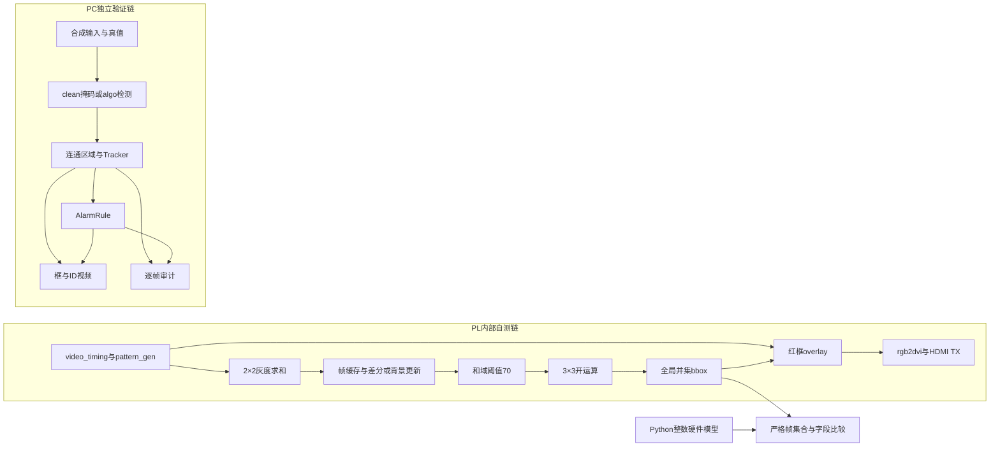

<!-- Hallmark · pre-emit critique: P5 H4 E4 S5 R5 V4; scope: technical report draft grounded in executed evidence. -->

# 基于FPGA的运动检测与跟踪验证——设计报告初稿

英文工作名：FPGA Motion Detection and Tracking Verification。

日期：2026-10-09。目标器件：XC7Z020-1CLG400C，板卡PYNQ-Z2。队名、学校、成员及报名组别待队长填写。源码基线ead15e0；本轮PC环境Python3.13.5，RTL仿真Vivado2025.2；归档实现报告来自2026.1。本文是可供全队接着补证据的初稿，尚不具备整机上板验收与最终提交条件。

## 1. 选题背景与创新点

本项目希望从视频运动区域中提取位置，并在目标穿过警戒线或持续停留时输出告警。当前已验证的成果分成两条链：PL中的内部合成激励、全局运动框和HDMI输出设计；PC上的多目标跟踪、告警和离线视频。两条链尚未以真实视频输入、板端传输和PS控制串成完整系统。

选择FPGA的依据是差分、阈值与局部形态学可按像素流处理，整帧历史数据可压缩后放入片上存储。PC软件用于观察算法行为和比对，不以PC运行成功证明硬件满足实际场景。运动前景不等于“识别人”，白色矩形合成片段也不能证明夜间人员入侵检测可靠。

当前可支撑的工程特点有两项：一是明确2×2求和、整数阈值、边界清零等口径，用Python整数模型逐帧核对RTL；二是把跟踪、事件和显示分开取证，再通过故障注入验证比对程序能发现漏帧与错误字段。这些是本项目已验证的方法，尚不足以宣称相对既有研究的算法创新。前人方案及公开作品的比较应由队伍补入实际引用与同口径数据；资料包列出的深度学习成绩与本轮12段子集不构成受控比较。

周界监测和区域停留检测是潜在应用。目前cross_out和连续停留仍有失败反例，因此应用价值应以“原型与验证平台”表述，不能写成已部署的可靠安防系统。

## 2. 设计原理与功能框图

下图实线表示源码中实际存在的处理关系；两条链没有用虚线预留接口伪装成已接通系统。

PL的2×2模块输出四个8bit像素之和，范围0–1020，需要10bit。阈值70作用在和域，不能解释为单像素70灰阶。形态学使用3×3方核、零扩展边界；输出不包含最外一圈无有效窗口的坐标。bbox为通过面积门限后的全局并集框，多个物体不会自动得到多个独立框。

背景模式的更新使用整数运算和移位，当前SHIFT6；具体舍入以`src/rtl/diff_stage.v`和`src/ps/rtl_golden.py`为准。PC algo的V43流程、预热和跟踪规则比这条RTL链更复杂，不能把V43历史F1归给当前PL实现。

存储量可直接算出：720p单帧8bit为921,600B=900KiB；640×360×10bit为288,000B=281.25KiB。按每块36Kibit计算，理想容量下限分别为200和63块，实际还受存储器宽深配置影响。归档整机80块BRAM是综合映射结果，不是理论下限。既有板级时序参数为1650×750总像素、74.25MHz像素时钟，对应名义60Hz时序；这只是设计参数推算，不能替代实测吞吐量和端到端延迟。

## 3. 软硬件划分依据与接口设计

本轮按实际实现划分：PL承担固定像素流运算与显示；PC承担参考模型、跟踪与告警原型、输出审计。尚无本轮证据证明这些Python任务已经在PYNQ的PS侧运行，因此这里使用“PC”称呼，PS控制路径保留为待验证设计。

PL板级时钟由125MHz输入产生74.25MHz像素时钟，rgb2dvi负责输出串化。`board_top.v`当前只有sys_clk输入及LED/HDMI TX输出，没有HDMI RX接口；控制参数为静态参数。当前既未验证AXI寄存器访问，也没有DDR/VDMA通路。将固定流算子放在PL可避免把每个像素往返搬运到CPU，但其实际节能或加速收益仍需同条件实测。

软件框使用原图1280×720坐标、包含端点；RTL框使用大像素域，显示时乘2。PS/PL传输的位宽与时序尚不能仅靠冻结表落地：LINE_X=640被标为大像素域、表中11bit与RTL16bit不一致、SHIFT表值5与当前参数6不同。具体问题及owner见[问题单](issues.md)。本轮没有自行定义通信协议。

当前未采用完整分辨率单帧片上缓存，容量算式可说明其超出目标器件资源；2×2缩小空间而保留10bit求和。DDR/VDMA、4×4压缩和复杂跟踪器是可比较的候选方案，尚无本轮实验，不写成“经过测试后放弃”。资料中的“卡尔曼/Hungarian搬不进PL”是过强断言，能否实现取决于目标数、精度、时钟与资源预算，本报告不采纳该绝对表述。

## 4. 实现与验证

本轮所有输出另存新目录。原124个Git基线文件使用SHA256前后核对，核心算法、冻结接口与参考结果不改。具体命令、解释器及依赖见[运行说明](../../docs/line3_run.md)和`run_ead15e0_01/manifest.json`。

### 4.1 跟踪和告警

合成片为120帧、1280×720、30fps，两个目标。clean采用理想掩码；algo使用实际检测链且`--init-frames 12`。为了避免粘连状态的一块区域被硬算成两个框，15个merged帧不进入目标召回分母，但其逐帧观察完整保存。剩余105帧、每帧两目标，共210目标实例。匹配优先最大匹配数，再最小化中心距离和；门限固定60px，端点误差另行报告。

| 项目 | clean | algo |
|---|---:|---:|
| 目标召回 | 210/210=1.000 | 186/210=0.885714 |
| 误检框 / ID互换 / 断航 | 0 / 0 / 0 | 0 / 0 / 0 |
| 方向判对 | 207/208 | 183/184 |
| 可见期最大框端点误差 | 0px | 1px |
| 告警CSV | frame43 id2；frame102 id1 | 相同 |

主分母包含algo前12帧的24个可见真值实例，因此0.886不能同时标注“排除预热”。如果另行排除预热，该片段为186/186=1；两种口径应并列注明，不能用后者替换主值。

两个方向不一致样本均为第92帧tid2反弹：估计vx=-4，真值vx=+12。这反映帧间位移与反弹后速度的定义可能不一致，需要线二确认，不能简单隐藏。cross_out真值在第32帧，此时merged而不可直接观察；软件却在67帧才把离开计数加1且不生成事件。总数碰巧一致不构成通过。

取证包装继承并调用原Tracker/AlarmRule，不重新实现算法。包装和原入口的CSV、告警表以及全部解码帧哈希一致。两视频均解码120帧；已查看普通运动、粘连与恢复帧，以及42/43/44、101/102/103帧，确认两条红色ALARM与相邻无告警画面。黑底上的黑色帧号可读性差，新增拼图底部单独标号；未改原视频。

### 4.2 独立用例与工具验收

25项小测试包含空掩码、单目标、分离目标、短遮挡恢复、进入/离开/重入、停留及CSV故障注入。20项PASS、5项FAIL，失败为左右离开、重入、非30fps停留秒数、连续停留遇缺测。完整输入、预期和实际值见`run_ead15e0_01/cases/cases.json`。

7种故障副本均被检出，行乱序被接受，代表性错误能定位到第2帧。第二轮增加18项工具验收，验证真实非零退出、拒绝覆盖、完整帧序列、坐标合法性以及日志换行；18项通过。本线工具通过不表示被测告警算法通过。统一入口真实返回2并保留5项FAIL。

### 4.3 RTL新仿真

原testbench在FRAMES12配置下只导出0–10帧，完整模型有0–11帧。旧工具只比共同帧会报告11/11一致；本轮严格比对把缺失11帧列为失败。读取收尾代码后，本线通过xelab参数把FRAMES调到13以排空，模型期望仍固定12帧，没有修改RTL或testbench源码。

| 配置 | CSV完整性/全字段 | 未知态与工具错误 | 显示检查 |
|---|---|---|---|
| 原台framediff | 11/12，FAIL | x_hits0，无ERROR | 原始结果保留 |
| 扩展framediff | 12/12，PASS | x_hits0，无ERROR | 12图红框范围精确匹配 |
| 扩展bg | 12/12，PASS | x_hits0，无ERROR | 12图红框范围精确匹配 |

仿真尺寸320×180，独立单矩形激励；DX16没有随720p宽高同比缩小。红框对应CSV第k−1行乘2，本轮使用0px容差即通过。每种模式的12张160×90掩码完整可解析，但尚未逐像素比对掩码，因此不写“所有像素完全一致”。沙箱内一次C编译失败已留档；获准以相同入口在沙箱外重试成功，未更改安全设置或安装工具。

### 4.4 板上验证

本轮没有连接板卡、生成新bitstream或下载测试。需要线一提供匹配源码提交的bit/hwh、加载日志、实测视频和输出对照；需同时记录帧率、丢帧与延迟。归档文字称“上板看到画面”不能替代这些原始证据。具体见[队友待补清单](team_evidence.md)。

## 5. 优化过程

本轮没有更改核心算法，也没有重做综合实现。能够核查的优化数据主要是历史CSV与历史资源报告，必须保持来源层级。

| 对比对象 | 已有数值 | 本轮证据性质 / 缺口 |
|---|---|---|
| PC存量V0 → V12 → V43 | 12段/7类宏均值0.442140 → 0.712857 → 0.736712 | 从CSV重算；无本轮原始CDnet复跑、TP/FP/FN或性能样本 |
| 归档board_top实现 | LUT10237；FF5979；BRAM80；DSP1；WNS+0.695ns；WHS+0.076ns | 2026-10-06 Vivado2026.1 Routed；缺同条件优化前报告与源码/bit对应证明 |
| 本线验收加固前 → 后 | 原台完整11/12 → 两模式排空12/12；工具18项通过 | 验证完整性改进，不是FPGA性能优化 |
| DDR/4×4等候选路线 | 未取得 | 不能给空白项编造资源、加速比或收益百分比 |

V43宏均值按每类内序列均值再对7类平均，约0.737；它不是整个CDnet全集成绩，也不是当前RTL的检测准确率。缺少原始数据和安全的异常输入处理，现时复跑会有静默错分风险，因此未下载整套数据来强行推进。

## 6. 大模型协作记录

本轮使用Codex桌面环境中的编程智能体，系统身份属于GPT-6系列；没有可核验的精确服务模型小版本。工具包括PowerShell、Python/NumPy/OpenCV、Git、Vivado/xsim以及文件图片查看；未使用Computer Use。没有子代理或虚构的多人评审。

真实过程包括：读取交接与源码、发现日志重复换行并修正、为帧集及坐标增加反例、实跑确认5项告警FAIL仍返回非零、尝试延长仿真收尾、保留编译失败并在允许的环境重试、依据XDC与CSV审计资料。原提示词与实际回答节选、错误及采纳结果见[协作记录](llm_record.md)。完整桌面聊天尚未导出，不能把这里的整理摘要冒充全量原始记录。

大模型在本轮的可用性来自工具验证，而非回答自信：首次新增工具运行后仍需要反例；沙箱失败并不能推出RTL错误；比较共同帧不能推出完整正确。交付前由程序检查原始文件哈希和文档数字，团队换手验仍待其他成员执行。

## 7. 技能包的提炼过程

仓库已有5项技能和1项刻意未沉淀的VDMA主题，本轮不复制凑数。新增[严格证据补充](../../skill/line3_strict_evidence/README.md)仅针对已发生的漏帧、比较工具故障注入和拒覆盖行为，复用本线compare/check_tools入口。

方法是先定义完整预期键集合，再检查重复、缺失、多余及字段差异，最后结合事件时刻和显示。这既适用于FPGA逐帧CSV，也适用于其他带稳定键的离线结果表；不自动适用于无序异步流或不同数值口径。整数精确比较与目标中心容差不能混为一谈；在大型多目标场景中，当前穷举匹配方法不适用。

## 8. 失败分析

已证实的行为缺陷集中在告警。side状态只在moving_in成立时更新，导致正常离开与后续重入处理不完整；dwell秒数硬编码30fps；无观测期间未按“连续”定义清零。第32帧merged使真值离开不可直接观察，算法应明示无法判断或恢复策略，而非在67帧产生迟来的无事件计数。

测试链的原缺帧由testbench收尾不足触发，排空扩展已在两模式验证。归档比较器忽略非交集属于验收方法缺口，本线严格比较补足，但公共文件未擅自改动。文档还有坐标域、CEC、容量与预热分母混用，应按问题单修订。

CDnet旧反例表明损坏输入可能静默跳过或补零，须队长修复后回归。cameraJitter和nightVideos的存量分类成绩偏低只说明所选子集表现，不足以确定每个失败场景的原因；缺原始数据时不进一步编造机制解释。

## 9. 复现说明

1. 使用源码基线ead15e0并包含本线提交，保留原资料。建议在新的纯英文项目路径放置复现副本，按运行说明安装独立环境；不要直接降级已有base。
2. 本轮实用环境：Windows、`D:\666666\Anaconda\python.exe`，Python3.13.5、NumPy2.1.3、OpenCV4.13.0、Matplotlib3.10.0。与requirements锁定版本不同，尚未做干净环境锁定版本复现。
3. 从仓库根运行`python -X utf8 sim/line3/run.py --out <新目录>`。应得到两模式CSV/视频、观察记录、严格差异、小测试和CDnet存量审计；ead15e0有5项行为失败，应返回2。
4. 运行`python -X utf8 sim/line3/check_tools.py --out <另一个新目录>`验证本线工具；它依赖已随仓保存的run_ead15e0_01观察记录并会重跑软件入口。当前期望18/18。
5. 用已有Vivado2025.2的settings64.bat，按运行说明执行run_rtl.py，输出至新的英文scratch和新evidence目录，指定`--drain-frames 1`；bg另加`--mode bg`。应有完整12行、无X且严格差异为空。所有PPM随证据保存。
6. 用`inspect_media.py --out <新目录> --wave <scratch/wave>`作精确红框检查；其软件拼图来源是固定基线证据，不能直接当成其他版本视频检查器。
7. 完整整机构建与上板步骤需线一按真实工具/IP/板卡环境补齐。现有build/board脚本供检查，不宣称本轮从零完整执行成功；没有板卡时停止在离线验收边界。

本报告已经具备可核查的离线验证部分。补齐板上实测、同条件性能基线、协议决议和另一成员的换手验后，才能作为整队最终报告定稿。
