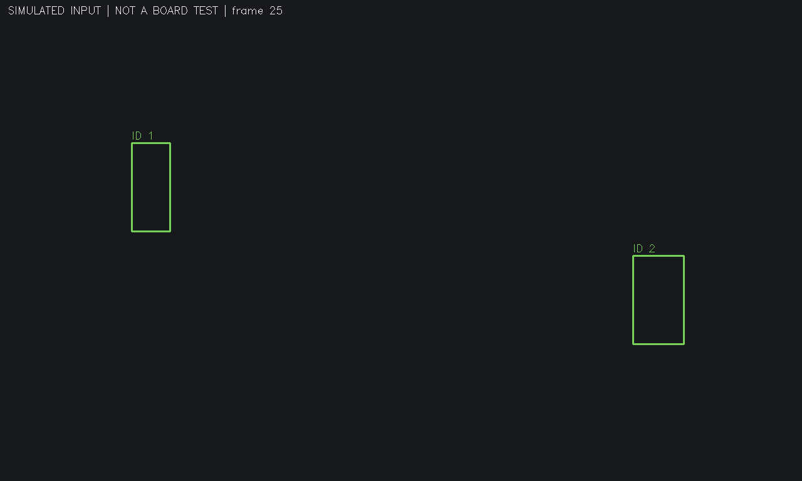

<!-- Hallmark · pre-emit critique: P5 H5 E5 S5 R5 V4; scope: evidence report, explicit incomplete boundaries. -->

# 线三真实数据与电脑端接收记录

2026-10-10阶段记录。真实CDnet数据已经完整就绪；电脑端模拟TCP接收与画框已通过检查。真实CDnet全量评分已启动，最终分数和与历史CSV的差异尚待评测结束后填写。这里没有把历史0.737写成本轮成绩。

| 工作 | 已验证的结果 | 尚未完成 |
| --- | --- | --- |
| 12段真实数据 | 50,356文件逐个比对落盘字节、CRC与SHA256；50,344张图片全部解码 | 无数据准备缺口 |
| 电脑端模拟接收 | 最终23/23检查通过；独立进程经TCP接收60帧，原始字节、编号、坐标及60张PNG核对一致 | 实际板端协议与联调 |
| V43/r12复现 | 隔离源码及运行器已启动；12段读取等价检查均通过，正式评分正在运行 | 全量结束、72行CSV及111,498行逐帧证据复核 |
| 既有修复回归 | 见 `../repair_20261010/README.md`，本轮没有重复运行 | owner换手审阅、资源时序与板测边界不变 |

## 数据来源与实际范围

原包：`C:/Users/孙伟博/Desktop/dataset2014.zip`，3,918,467,615字节。SHA256为 `05c6d0dd64858b094cb0d309e5b63be42de52f2b5c5adff4a65e6a640dfd2a84`。旧会话已完成全包CRC检查；本轮重新计算原包SHA256，并对选中的每个文件重新读取、验证、落盘复读和解码。

解压根目录为 `D:/cdnet2014_line3_20261010_1700`，实际评测数据根为其下的 `dataset`。未覆盖原包、历史CSV或旧证据。

本轮提取每段所有 `input`、`groundtruth`、`temporalROI.txt`、`ROI.bmp`，共505,521,999字节。交接中505,942,828字节还包括12张辅助 `ROI.jpg`，本轮未提取这420,829字节；差异逐项列在 `evidence/excluded_ancillary_members.json`，不存在漏计分帧。

逐文件清单保存在 `evidence/dataset_file_manifest.csv.gz`，含ZIP成员名、字节数、CRC32、SHA256及解码尺寸。解压后的清单SHA256为 `2c7e434dfef587de2100bc1b5533096b0e87ecb48057a7c86272f78979cff7e6`。逐序列计数与全部核验结果见 `evidence/dataset_verification.json`。

### 本轮发现的材料边界

1. 原包中的 `cameraJitter/traffic/ROI.bmp` 为352×240，输入与真值为320×240。直接从ZIP再次读取，尺寸差异一致。它不是提取后损坏；本轮保留原图，并单独记录空间ROI尺寸差异。现有评分代码没有读取 `ROI.bmp`，只对真值标签0和255计分。这里复现的是队伍现有计分实现，不能据此宣称完成所有官方空间ROI规则的独立审计。
2. 真实CDnet序列保留各自分辨率，软件做原尺寸的2×2求和；并没有全部缩放到硬件720p对应的640×360域。各序列尺寸已留在数据清单。硬件接口表里的640×360不能直接当成这些离线序列的尺寸。
3. 12段覆盖7类，每变体18,583个计分帧；这是选定子集，不是完整CDnet2014总成绩。历史V43类别平均由已四舍五入CSV重算为0.7367119047619047，显示为0.737；本轮实际值仍待全量评测结束。

## 真实评测如何运行

固定源码：`ae5a7d8f77abe577a165b015a83d087f9cb65457`，隔离目录 `D:/line3_cdnet_20261010_1700/source`。`src/ps`算法源码和历史结果均不修改，wrapper与输出位于仓库外。

本机16GB内存，启动前可用约2.3GB。原入口缓存完整序列会占用较多内存，因此观察运行器只替换帧的存储/读取方式：按原来的BGR→灰度→2×2求和逻辑按需取帧，保留小缓存。原 `frame_metrics` 与 `cdnet_official.main` 仍执行，参数没有调整。

正式计分前，对12段各取100帧预热和30帧计分，比较原缓存读取与按需读取的每张灰度图、压缩图、真值图，以及r12全部6变体的逐帧指标；任何差异立即退出。12/12段检查已全部精确通过，见 `evidence/loader_parity_snapshot.json` 的 `loader_equivalence`。这是每段130帧的存储等价检查，不能代替完整ROI评分。正式全量已进入snowFall，最终结果仍待结束。

真实启动命令（2026-10-10 16:53:06，启动PID 32740）：

```powershell
& 'D:/666666/Anaconda/python.exe' -X utf8 D:/line3_cdnet_20261010_1700/tools/run_observed.py --source D:/line3_cdnet_20261010_1700/source --data-root D:/cdnet2014_line3_20261010_1700/dataset --out D:/line3_cdnet_20261010_1700/evaluation01
```

运行器调用的原入口参数是 `--set r12 --seq all`、默认预热100、`--frames 0`完整ROI。r12为V0/V12/V43/V45/V46/V47；每个变体配置、Python/NumPy/OpenCV版本、源码哈希和CSV前后哈希都写入 `run.json`。仅重定向原入口的输出位置，不覆盖原来的 `src/ps/cdnet_official_results_r12.csv`。

实时日志为 `evaluation01/stdout.log`、`stderr.log`；最终退出码在 `run.json`。`per_frame.csv.gz`记录每段、每变体、每帧的P/R/F1、TP/FP/FN和真值前景数。运行结束后执行：

```powershell
& 'D:/666666/Anaconda/python.exe' -X utf8 D:/line3_cdnet_20261010_1700/tools/compare_observed.py --run D:/line3_cdnet_20261010_1700/evaluation01 --reference D:/line3_cdnet_20261010_1700/source/src/ps/cdnet_official_results.csv
```

比较器重新从逐帧计数聚合分数，核对12×6完整键集合、每帧编号覆盖、每段四位小数结果与逐帧平均，不以总分相等代替逐项核对。汇总按类内平均后再对7类平均。若不同，保存差异并诊断，不调参追分。

## 电脑端模拟接收证据

用法与待确认协议在 `../../docs/line3_pc_receiver_proposal.md`。最终测试命令为：

```powershell
& 'D:/666666/Anaconda/python.exe' -X utf8 sim/line3/check_pc_receiver.py --out D:/line3_cdnet_20261010_1700/receiver_test02
```

实际退出码0，23/23通过。测试包括拆包/粘包、UTF-8错误、重复键、缺字段、非法坐标/编号、空流、缺帧、重复帧、乱序、截断、超长行恢复、磁盘增长限制、坐标边界和真实本机TCP。`evidence/receiver_test02.zip`保留完整原始流、输入、接收结果、拒收记录、命令/退出码及输出图片，已检查ZIP CRC。摘要为 `evidence/receiver_tests.json`。



空白背景是坐标画布，图上两框来自模拟器。用户已明确同意先做此部分；尚未提供板端传输协议。此结果不证明真实板端输出、视频同步、报警或延迟验收通过。

## 保留的失败与过程修正

以下为工具实际输出的摘要，非重新生成的原始日志。

| 尝试 | 真实结果 | 处理 |
| --- | --- | --- |
| 顺序提取v1 | 为改善大量小文件写入耗时主动停止；进程退出1 | 保留已写文件和部分清单，后续读取比对，不覆盖 |
| 并发v2 | 完成snowFall后触发 `ValueError: ZIP destination escaped root`，退出1 | 保留脚本和部分清单；调整先创建已验证相对父目录、再解析路径的顺序；未声称已证明Windows根因 |
| 并发v3 | 完成5段后触发 `Shape mismatch: dataset/cameraJitter/traffic/ROI.bmp`，退出1 | ZIP直读确认原包尺寸差异；输入/真值仍强制同尺寸，空间ROI单列记录 |
| 最终提取 | 12/12通过，进程退出0；最终一轮208.97秒 | 文件内容逐个复核后形成最终清单 |
| 接收test01 | 22/22通过，退出0 | 之后新增输出数量限制和独立提示栏，未覆盖原记录 |
| 接收test02 | 23/23通过，退出0 | 作为当前版本证据 |

旧脚本、部分清单和test01收在 `evidence/preparation_prior_attempts.zip`，CRC已检查；原始D盘目录也保留。

## 仍需接续

等待当前评测结束，检查退出码与日志，运行完整集合比较，再把真实结果和差异补入本报告并同步原草稿PR。板端联调需线一/线二提供实际连接和包格式。完整板测属线一，资源时序主要属线二，模块owner换手审阅由另一队员完成，不能用本次模拟或作者自检代替。
